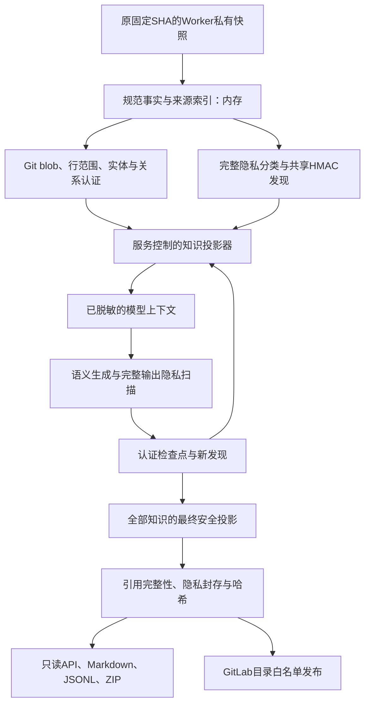

# 原提交中含硬编码凭证时的 Project Brain 设计

日期：2026-10-20。状态：**2.0.0真实构建已隔离；2.0.1历史发现继承修复已通过离线回归与原SHA回放，尚未重新真实生成**。结果与限制见[验收记录](project-brain-sensitive-source-validation.md)及[继承设计](project-brain-privacy-inheritance.md)。

## 1. 已确定的产品要求

Project Brain 必须能直接分析原始固定提交，包括硬编码凭证、普通名称与凭证同值的情况。修改业务源码、删除旧隐私指纹或更换提交都不能作为接入前置条件。本服务继续只写 `PROJECT_BRAIN.md` 与 `docs/project-brain/`，不自动修改业务代码。

采用 **私有规范来源 + 稳定不透明身份 + 安全知识投影**。识别敏感值后替换模型输入与全部公开产物中的内容，同时保留真实源码事实的内部认证。原 SHA、Git blob、原始行范围、实体归属、关系端点和候选状态仍由服务验证。

这不是恢复原值，也不是允许敏感路径原样输出。它将“真实来源是否成立”与“哪些文字允许对外展示”拆开。敏感路径隐藏后，可点击链接率可能下降；证据不因此被删除或伪造。

## 2. 当前失败与需要改变的契约

1.1.5 的实际试点中，一个值既出现在凭证环境变量读取的默认参数，也出现在四个源码路径与81条来源引用。v2来源、实际输入组、固定blob和AST均已核验。本次分类有明确依据，但不证明该值有效或当前部署使用。

当前 `SourceRef.path` 同时用于快照读取、blob/行范围校验、上下文分包、Markdown链接和JSONL/ZIP导出。保持原路径会泄露同值，直接改路径会破坏证据。这是契约耦合，不能靠提示词解决。

还有两个同类问题需要一并处理：

- 直接对 `files` / `observations` 字典键脱敏，可能让不同键变成相同文字而丢条目；任意属性键也有此风险。
- `ArtifactStore.read_bundle()` 的正式脱敏数据被用于 `FactExtractor._restore()` 恢复解析状态；安全展示不能作为真实导入、调用和路径的解析基准。

## 3. 数据流



私有快照保持原文件，不执行目标项目代码。路径定位对应关系在Worker从固定SHA重建，不创建新的持久可逆脱敏映射。临时源码不进入API或publisher挂载的正式产物卷。

## 4. 身份与展示的具体结构

### 私有规范来源

`source_catalog.py` 的 `SourceCatalog` 保存文件/证据不透明ID到真实Git路径、blob、行范围、模块和符号归属的内存索引。解析和关系确认在原源码上完成，随后认证与投影。模型不能提供或修改这份索引。

身份与当前隐私发现数量、脱敏占位符或展示名称无关。使用项目作用域、带版本且区分用途的HMAC生成文件、模块、实体、关系和来源ID；包含相应规范身份信息，来源绑定包含固定提交、blob与行范围。不同项目使用不同私有身份材料。

项目身份密钥应放在独立Worker私有identity区，不能放在成功构建会清理的 `work/<build>/privacy`。API/publisher不挂载该区；清理、备份、轮换和历史引用保留需显式实现。仅保存密钥与不可逆认证元数据，不保存凭证原值、原始上下文或路径反查表。丢失密钥时拒绝伪造旧身份，以新身份版本和新构建恢复。

身份密钥用于来源稳定性；现有构建隐私账本密钥用于敏感值匹配，两者分开，不能直接拿每次变化的隐私占位符当实体ID。

### 对外安全来源

新增独立公开Schema，不能继续把它当作内部 `FactBundle`。

```json
{
  "id": "evidence_<opaque>",
  "source_file_id": "file_<opaque>",
  "commit_sha": "<原完整SHA>",
  "blob_sha": "<原Git blob>",
  "line_start": 44,
  "line_end": 44,
  "display_path": "app/<已脱敏>/settings.py",
  "path_redacted": true,
  "link_status": "redacted",
  "source_url": null,
  "verification": "service_verified"
}
```

这里的 `display_path` 只用于显示，绝不用于打开文件、执行Git操作或查找符号。提交、blob、原始行号与不透明来源ID绑定；脱敏后片段长度或换行变化不参与原源码行范围认证。

只有原路径、项目URL及最终URL都通过当前过滤且未被改写，才生成指向固定提交的直接链接。敏感路径不生成假链接、不做包含原路径的302跳转，也不通过URL编码输出原值。文档显示“路径已脱敏；来源已由服务校验”，附来源ID、blob与行范围。

这是服务对来源的认证，不宣称没有私有材料的接收方能独立验证原路径。拥有仓库权限的人仍可用固定提交和blob对照；后续本地验证工具可以在用户自己的仓库中定位，不由服务发布原路径。

### 文件、模块和属性

- `files` 和 `observations` 使用不透明文件ID关联，展示路径放在字段中；两个文件即使显示文字完全相同，仍保留两个条目。
- 模块与符号身份使用不透明ID，名称、签名、职责、关系目标名称、配置名称及未知项都是待脱敏展示文字。
- 来源派生的未知属性键也需要扫描。若替换可能重名，使用带键ID的条目列表保存，不能用普通字典赋值覆盖。复杂未知结构应拒绝或走完整结构投影，不能静默忽略。
- 已认证的服务机器字段按严格Schema绑定，不对整个对象无差别替换。不能仅因任意未知值“像哈希”就免扫。
- 事实、关系、候选目标、证据和未知项保持完整。脱敏是隐藏值，不是删除有敏感值的函数、接口、模块或结论。

## 5. 模型上下文与晚发现

1. 先从固定SHA提取完整规范事实，确定模块和分包，再生成安全传输副本。源码片段由私有索引读取，不通过显示路径读取。
2. 在语义生成前完成全部将使用的源码摘录和结构事实扫描。现有收据、分包、超长单字段、时间窗口和预算门禁继续使用；这是调整先后顺序，不是减少必要扫描。
3. 模型只接收安全文本和服务分配的来源/槽位别名。明确标识凭证已隐藏；只解释配置作用、读取位置和依赖，不能猜测原值。
4. 输入完整清扫、输出与必要reasoning完整清扫、格式和证据校验都保留。出现真实秘密仍登记全局HMAC，覆盖后续所有同值位置。
5. 若后来又发现秘密，先认证已有检查点，再在内存中生成最新安全副本。只因展示路径或文字需要再脱敏，不重新调用语义模型，不删除原有结论与未知项。

必须区分两个摘要：

- **规范/检查点摘要**：绑定固定SHA、配方、真实来源、子检查点身份和已经付费且合规的完整结果。不可因新脱敏规则整体重写旧envelope。
- **安全投影/传输摘要**：绑定本次实际传输或发布的安全副本与完整隐私修订。文本变更可使此摘要变化，不改变来源身份。

叶级 `SourceBoundPlan` 与汇总均使用规范来源摘要，不能继续让叶级scope取决于清扫后文字。完整副本的字段全集、主体归属、来源集合、候选状态和投影合法性都要验证。来源绑定不等于模型解释已获语义证明，结论仍为 `AI_INFERRED/unreviewed`。

若脱敏后无法保留有效必填结构、输出路径或容量，明确失败并保留费用；不能把它当作隐式重生成或截断理由。

## 6. 正式产物与所有出口

`ArtifactStore.finalize()` 只接收已认证的公开知识类型。以下内容必须由同一安全投影生成并纳入清单：

- 六类卡片与Markdown、详情结论、概览、未知项；
- `facts.json`、符号/关系/证据JSONL、查询与导航索引；
- manifest覆盖统计、问题清单、展示名称和文档文件名；
- API响应中的分支展示、错误、覆盖、发布状态与MR链接；
- ZIP内文件名、内容及其完整性清单；
- GitLab提交内容与清单。

模型建议的文档路径若被脱敏或与其他文档冲突，使用服务生成的不透明卡片ID路径，仍限定在 `docs/project-brain/`。记录映射，不覆盖人工文件，不删除卡片。`PROJECT_BRAIN.md`固定入口保留。

ZIP改为显式公开文件清单，不再遍历暂存目录打包全部内容。禁止包含源码、私有索引、工作检查点、隐私账本、身份密钥与映射。

API不挂载私有材料，而是读取已封存的安全元数据。URL不能安全原样输出时为空，不能返回替换后的假URL。GitLab真实目标分支仍从DB操作身份读取，不使用公开manifest中的脱敏显示文字执行Git操作。

清单披露公开Schema、投影版本、身份版本、隐私封存标识、脱敏路径数及直接链接覆盖率。证据有效率、链接可用率、事实召回率和业务回答正确率分别统计。

## 7. 版本、增量、重启和封存

- 新协议必须使用新配方和新构建；原1.1.5失败记录、已花费用、未知预留与检查点不清零，不混用新代码续跑。
- Worker重启后从同一固定SHA与项目身份密钥重建私有索引，核对检查点摘要、全部私有材料与租约，再重放隐私发现。不通过新建空账本补齐丢失历史。
- 新公开知识不能传给 `FactExtractor._restore()`。2.0.0先完整静态提取当前SHA；同构建完成检查点可以恢复，暂不跨构建复用语义结果，`cache_hits=0`。需要文件级提取增量时，在Worker从基准SHA重建规范观察。不要用失真的脱敏导入或名称重新解析关系。
- 跨构建缓存后续接回时，仍须认证来源、重放当前隐私修订、验证完整输出和全部引用后才继承完成。此次优先恢复原提交支持与完整隐私保证，不宣称已完成新的增量成本优化。
- 最终组装在全部必要任务完成后读取最新完整账本，对所有早期结果、名称、文件名与外层元数据重新投影。比较投影前后实体、关系、来源和候选集合，不能靠数量相等代替身份双射。
- 产物绑定隐私封存摘要；用DB租约/请求序号与私有账本封存核对防止晚响应改变已发布版本。组装前和ready事务内均核对：所有其他单元完成、调用全部结算、每单元无活跃/未知预留。未通过则以 `model_calls_incomplete` 终止，保留费用，核对响应后可重试组装。迟到发现触及已封存版本时，以 `privacy_seal_conflict` 清除当前指针并禁止API/发布；不能重试已关闭的隐私历史，显式新建请求创建独立generation，不清除旧账。
- FS和DB不是同一事务。恢复必须能处理产物已写而ready未提交等窗口，不能承诺全局零竞态或零额外费用。
- 私有身份区与审计材料保留周期独立于普通work清理，仍仅Worker可访问。新增持久字段时必须Alembic迁移；先API及迁移，后Worker/Beat。
- 新公开Schema用显式版本分派，旧格式保持legacy读取；旧程序不能把新公开视图当成旧解析缓存。回滚保留表/卷/新版本，不给旧产物补称新保证。

## 8. 实施切分

| 阶段 | 主要修改 | 完成门槛 |
|---|---|---|
| 1 | `source_catalog.py`、私有身份材料、公开Schema与`knowledge_projection.py` | 原SHA合成凭证/路径碰撞可投影，身份篡改拒绝 |
| 2 | `privacy_identity.py`、`brain_task.py`、`compiler.py`、`trusted_packet.py`、`source_bound.py` | 规范身份/传输摘要分离、摘录先扫描、晚发现不重复语义调用 |
| 3 | `summary.py`及规划/检查点缓存 | 已付结果先认证再投影，完整详情和未知项保留，重启/并发通过 |
| 4 | `artifacts.py`、API/发布元数据、ZIP、增量输入与独立审计 | 全部出口只读公开投影，不以脱敏路径验证真实源码 |
| 5 | 独立本机栈模拟链和完整回归，新配方真实试点 | 保持原SHA；先有界验证，再完整构建和50题评估 |

这些步骤是同一功能的实施切片。只完成其中部分时，旧终止门禁仍保持，不能先放宽门禁部署一个不完整出口方案。

## 9. 验收矩阵

1. 同值在凭证默认参数、路径、模块、符号、关系名、说明、unknowns和建议文档名中出现：原SHA不变，全体公开出口不含原值。
2. 普通名称不因命名习惯被擅自认定安全；已确认秘密仍全局替换。第一参数环境变量键与第二参数默认值分开，别名/遮蔽按真实静态语义处理。
3. 两条显示路径或属性键替换后相同：条目不减少，身份及引用仍一一对应。
4. 候选/未知不升级为resolved；事实、关系、证据、详情与unknowns完整保留。
5. 修改规范路径、blob、行号、归属、关系状态，或注入任意显示路径/URL：拒绝认证或发布。
6. compile后、summary后和assembly中出现新发现：重新投影全部出口，旧已付envelope不被改写，不因脱敏自动重生成。
7. Worker重启、缺/坏key、坏MAC、重复投递、晚响应、预算等待及文件/DB非原子窗口：不丢发现、不清费用、不错误ready。
8. 新增/删除/重命名与不同版本敏感路径：公共安全图不能充当解析真值，失效知识不残留。
9. ZIP逐成员检查文件名和解压内容，包含URL的Markdown/JSON统一检查，禁止私有文件混入。保留发布路径白名单、人工所有权和防递归回归。
10. 完整ready后再对固定源码验证证据与50题质量；脱敏、协议和引用通过不代替业务回答准确率。

## 10. 已接通的实现与运维约束

- 来源身份：项目密钥及锚点在Worker私有 `source-identities/<project_id>/1/`；完成的extract记录登记已有身份，之后整个目录丢失也不自动生成替代密钥。文件缺失、MAC/锚点损坏均停止；当前不提供自动轮换或自动删除身份材料。
- 隐私发现：初始privacy单元扫描事实和所有计划源码摘录，再保存安全facts检查点；`source_privacy` 屏障完成后才开始语义编译。完整扫描、字段上限、费用和输出门禁均保留。
- 公开数据：`public_schema.py` / `public_projection.py` 输出Schema2；服务属性保留独立条目，显示重名不覆盖。`ArtifactStore.read_bundle()`拒绝新格式作为解析缓存，公开读取使用 `read_public_bundle()`。
- 封存与审计：`source-seals/<build_id>/` 独立于临时work；`source-audits/<build_id>/privacy/`保留认证key、HMAC指纹及state/seal四个文件，不保存源码、原值、可逆映射或收据。API/publisher不挂载这些目录。当前保留这些小型私有材料，需与身份区一起备份，不能按普通work清理或擅自轮换密钥。
- 所有产物、卡片、Markdown及ZIP出口走同一公开投影。API通过DB内的manifest哈希认证公开元数据；进行中/失败版本不返回原始分支、单元key或自由错误正文，MR链接无法重新认证时为空。发布使用DB实际分支，路径权限仍只有固定入口与 `docs/project-brain/` 后代。
- 独立审计支持 `scripts/brain_quality_audit.py --source-identity-key <Worker私有identity.key>`，新格式还需对应保留的隐私账本。仅在受信本机/Worker使用；参数、密钥和原始路径不会进入报告。缺材料明确拒绝评分，不以显示路径或生成器事实替代固定SHA的独立AST真值。
- 此次无新增环境变量或DB迁移。新配方为 `project-brain/2.0.0`，不能在1.1.5检查点上继续运行。旧Schema1保持显式兼容读取，不能给它补称Schema2的保证。

## 11. 验证进度与限制

`secrets/brain-source-projection-20261019/` 下保存独立合成原型、13项检查与闭合结果。它调用现有 `PrivacyLedger` / `LedgerPrivacyFilter` 和真实Git blob/行范围校验函数：先复现现有身份门禁，再验证不透明身份、脱敏展示、禁用敏感链接、显示重名不丢条目、原SHA/关系保持、晚发现不改规范绑定、篡改拒绝及ZIP公开文件清单。网络连接被替代为立即失败，实际尝试为零。

独立原型为13项通过。正式实现另有完整模拟Worker链，使用真实租约、静态提取、来源认证、隐私发现、编译与分层规划、组装、封存及ZIP，在合成模型/GitLab/Broker替身下达到ready，核对所有公开成员无合成凭证、原SHA和源码字节及旧费用不变。完整回归结果见验收记录；这些模拟结果不证明真实模型分类召回、真实GitLab发布或50题业务质量。

此前单次真实重建授权已执行完，本轮账面余额3,539,187 Token及653,732旧未知预留继续保留。本设计/离线原型没有新增真实模型费用；2026-10-20另获一次独立800万Token完整构建及50题评估授权，旧轮余额/未知预留不改，具体构建见验收记录。
